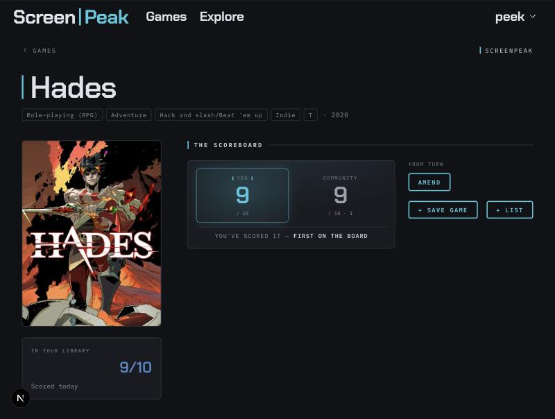
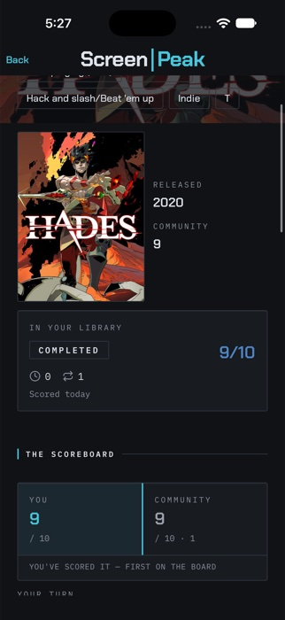
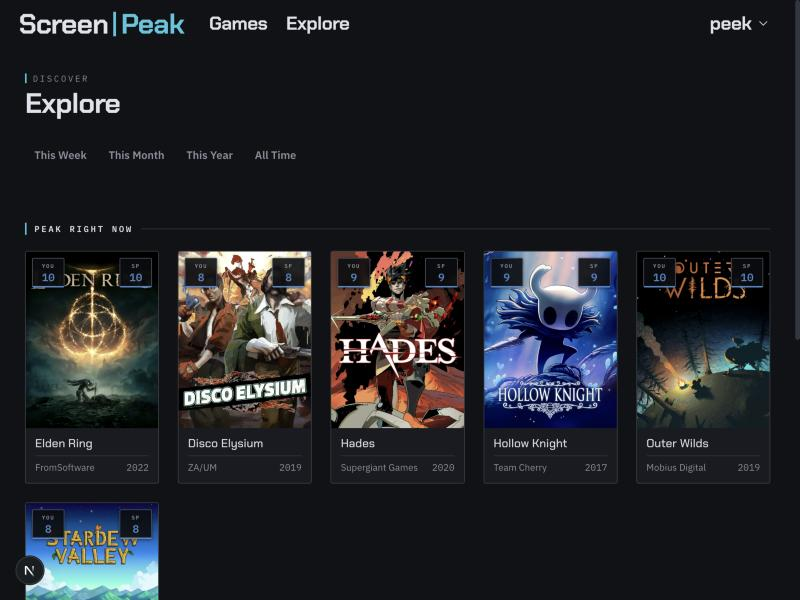
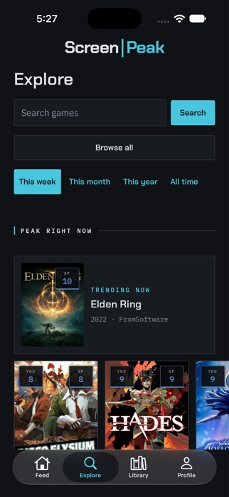
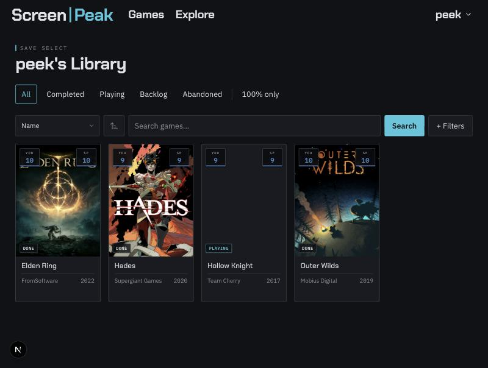
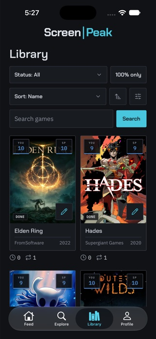
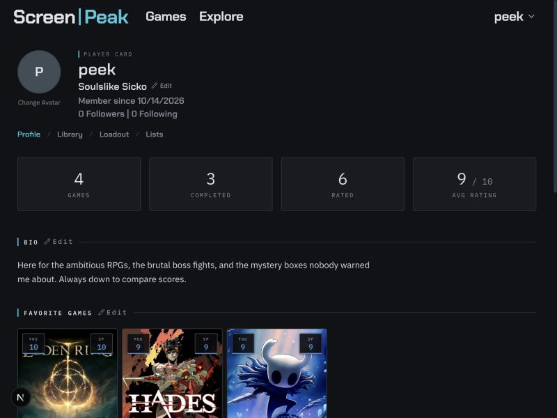
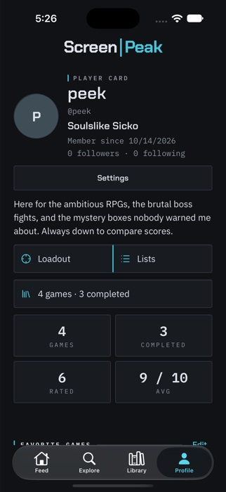
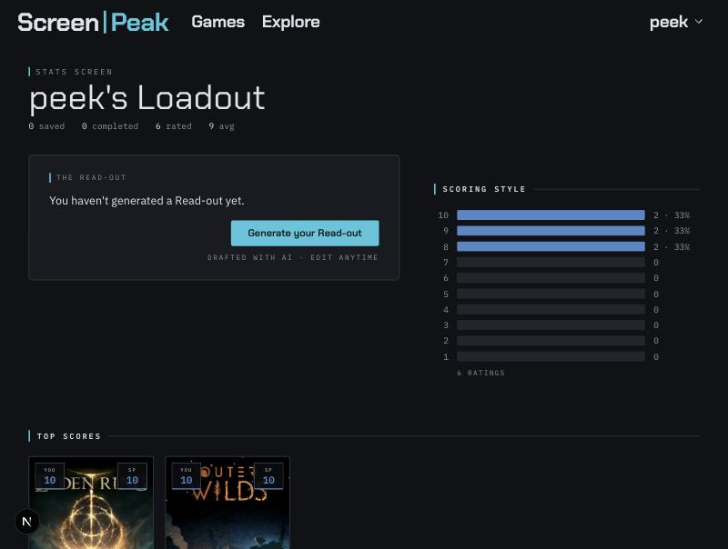

# ScreenPeak

**Screen-peeking at what your friends play.** ScreenPeak is a gaming-profile
app — a Next.js website and a native iOS/Android app sharing one backend:
track your library, rate and review what you've played, build lists, follow
other players, and get an AI-written "Loadout" that describes who you are as a
gamer.

The defining idea is **you and the community** — every game shows two scores,
both out of 10, side by side: the ScreenPeak community average, and yours.

> The repo directory is historically named `ng-plus`. The product was renamed
> from **NG+** to **ScreenPeak** over a trademark conflict. Some internal
> identifiers keep the old name on purpose — the DB column `ngplus_rating`, the
> RPC field `avg_ngplus_rating`, and the sort key `ngplus_rating`. These are
> wiring, never surfaced in the UI; renaming them needs a DB migration.

## Screenshots

Web on the left, the native app on the right — same backend, same "you vs.
community" idea, two different screens.

<table>
<tr><th>Web</th><th>Mobile</th></tr>
<tr>
<td></td>
<td></td>
</tr>
<tr><td colspan="2"><strong>Game detail — the Scoreboard.</strong> Your score and the community's, side by side.</td></tr>
<tr>
<td></td>
<td></td>
</tr>
<tr><td colspan="2"><strong>Explore.</strong> Trending games this week, with a featured card up top.</td></tr>
<tr>
<td></td>
<td></td>
</tr>
<tr><td colspan="2"><strong>Library.</strong> What you've played, rated, and finished.</td></tr>
<tr>
<td></td>
<td></td>
</tr>
<tr><td colspan="2"><strong>Profile.</strong> Bio, favorites, stats, and the Loadout/Lists split.</td></tr>
</table>



**Loadout** — an AI-written paragraph (Claude) describing who you are as a
gamer, generated from your ratings, library, and favorites.

## Tech stack

This is an npm-workspaces monorepo: a Next.js website (`apps/web`), a native
Expo app (`apps/mobile`), and a dependency-free package of code shared between
them (`packages/shared` — types, Zod schemas, constants, design tokens). The
rest of this README documents `apps/web`; see `apps/mobile/AGENTS.md` for the
mobile app's own conventions.

| Area | Web (`apps/web`) | Mobile (`apps/mobile`) |
|------|-------------------|------------------------|
| Framework | Next.js 16 (App Router, React 19, Server Components) | Expo (React Native), Expo Router |
| Language | TypeScript (strict) | TypeScript (strict) |
| Styling | Tailwind CSS v4 (config-less, `@import "tailwindcss"` + CSS custom properties) | `StyleSheet` + design tokens (`packages/shared/tokens.ts`) |
| Data | TanStack Query against the website's `/api/v1` routes | same |
| Tests | Vitest + Testing Library | Vitest + Testing Library |

Shared across both:

| Area | Choice |
|------|--------|
| Backend | Supabase (Postgres, Auth, Storage) — Auth/Storage via `@supabase/ssr`, everything else via Drizzle |
| ORM | Drizzle ORM (`drizzle-orm`, `postgres`) — direct Postgres access outside Auth/Storage |
| AI | Anthropic SDK (`@anthropic-ai/sdk`) — Loadout identity text |
| Validation | Zod |
| Auth (Steam) | `openid` (Steam OpenID 2.0) |
| Lint | ESLint (`eslint-config-next`, core-web-vitals + TypeScript) |

## Getting started

### Prerequisites

- Node.js 20+ (developed on Node 24)
- A Supabase project (Postgres + Auth + Storage)
- API keys for Twitch (IGDB), Anthropic, and Steam (see below)

### Environment

Create `apps/web/.env.local` (gitignored). The Next.js app and the catalogue scripts read that file, not a `.env.local` at the repo root.

```bash
# Supabase — client-side (public)
NEXT_PUBLIC_SUPABASE_URL=https://<project>.supabase.co
NEXT_PUBLIC_SUPABASE_ANON_KEY=<anon-key>

# Supabase — server-only secret (admin client: account deletion)
SUPABASE_SECRET_KEY=<service-role-key>

# Postgres — Drizzle's direct DB access (lib/db.ts and lib/queries/*)
DATABASE_URL=<session-pooler-connection-string>       # read by apps/web/drizzle.config.ts; schema changes are applied with migrate:journal, not drizzle-kit push
DATABASE_POOL_URL=<transaction-pooler-connection-string> # the app's runtime client; throws at module load if unset

# Absolute site URL — used as metadataBase and for OG tags (optional in dev,
# defaults to http://localhost:3000)
NEXT_PUBLIC_SITE_URL=http://localhost:3000

# External APIs
TWITCH_CLIENT_ID=<twitch-client-id>         # IGDB catalogue seed and Steam-app matching
TWITCH_CLIENT_SECRET=<twitch-client-secret>
ANTHROPIC_API_KEY=<anthropic-key>           # Loadout identity generation
STEAM_API_KEY=<steam-web-api-key>           # Steam library import + achievements
```

### Install & run

```bash
npm install
npm run dev      # dev server on http://localhost:3000
```

### Database schema & migrations

The schema lives in `apps/web/db/schema.ts` / `db/relations.ts` (Drizzle) plus
hand-authored SQL in `apps/web/db/migrations/`. Applied files `0000`–`0008` and
`db/migrations/meta/_journal.json` are the journal. Do not edit them, and do
not apply schema changes with `drizzle-kit push`.

A new migration is the next SQL file plus a journal entry. On an empty local
Postgres, create the auth stubs first, then apply. Hosted apply uses the same
command with `--target-hosted` and the host and database name typed from the
URL. The exact commands are in [docs/igdb.md](docs/igdb.md).

```bash
psql "$LOCAL_DATABASE_URL" -v ON_ERROR_STOP=1 -f apps/web/db/local/auth-stubs.sql
npm run migrate:journal -w @screenpeak/web -- --database-env LOCAL_DATABASE_URL --apply-pending
```

A table created via raw SQL (rather than Supabase's own dashboard/tooling)
does **not** automatically get its `anon`/`authenticated`/`service_role`
grants — only RLS auto-enables. If the app gets `permission denied for table
...` (Postgres `42501`) even though RLS policies look right, check
`information_schema.role_table_grants` and `GRANT` the missing privileges.

### Seed game data

Catalogue seeding reads IGDB with Twitch credentials. It upserts games and
does not clear library entries, reviews, lists, or accounts. `/steamlink`
matches a Steam library through IGDB (`lib/catalog/steam-import.ts`).
See [docs/igdb.md](docs/igdb.md).

```bash
npm run seed:igdb -w @screenpeak/web -- --database-env NAME --top
```

## Scripts

```bash
npm run dev         # Next.js dev server
npm run build       # production build
npm run start       # serve the production build
npm run lint        # ESLint
npm run seed:igdb -w @screenpeak/web -- --help   # IGDB catalogue seed (see docs/igdb.md)
npm test            # run the Vitest suite once
npm run test:watch  # Vitest in watch mode
npx tsc --noEmit    # type-check (no dedicated script)
```

## Project structure

Paths below are relative to `apps/web/` unless stated otherwise.

```
app/                     Next.js App Router
  page.tsx               landing (logged out) / activity feed (logged in)
  layout.tsx             root layout — fonts, NavBar, UserProvider, +1 layer
  globals.css            design tokens (CSS custom properties) + the one keyframe
  explore/               discovery — trending games, lists, recommendations
  games/                 game browse + filters
  games/[slug]/          game detail — You and Community, reviews, screenshots
  user/[username]/        profile
    library/             the user's tracked games
    lists/  lists/[listId]/  user lists + list detail
    loadout/             AI "Loadout" identity page
    ratings_reviews/     the user's ratings & reviews
  settings/              account settings (email, password, username, privacy, Steam)
  steamlink/             Steam library import flow
  auth/confirm/          landing point for every Supabase auth email link
  auth/update-password/  password-reset form
  api/
    loadout/             POST — generate the Loadout paragraph on demand
    steam/link/          GET  — start Steam OpenID sign-in
    steam/callback/      GET  — verify Steam OpenID, link the account
    delete-account/      DELETE — wipe the signed-in user (admin client)
  components/            UI components by domain: user, game, library, lists, feed, settings, util
  feed-actions.ts        server action — paginate the activity feed
  library-actions.ts     server actions — library entry CRUD, Steam import upsert
  review-actions.ts      server actions — submit/update a rating & review
  list-actions.ts        server actions — create/update/sync/like a list
  user-actions.ts        server actions — profile, privacy, favorites, follow, loadout bio
  steam-actions.ts       server actions — link/unlink Steam account
                         (all derive the caller's identity from requireUser(), never a client-supplied id)

db/
  schema.ts              Drizzle table definitions + RLS policies
  relations.ts           Drizzle relational query config
  migrations/            hand-authored SQL: functions, triggers, and RLS/grant
                         fixes that drizzle-kit doesn't model from schema.ts alone

lib/
  supabase-*.ts          three Supabase clients (see below)
  db.ts                  Drizzle client — direct Postgres, everything outside Auth/Storage
  auth.ts                requireUser() — server-side identity for Server Actions (throws if unauthenticated)
  dates.ts               parseDbTimestamp() — normalizes postgres-js's timestamptz text before parsing
  sql-helpers.ts         uuidArrayParam() — builds a real Postgres array literal for raw RPC calls
  supabase-logging.ts    logging fetch wrapper for Supabase calls
  loadout.ts             build Loadout input data + call Anthropic
  logger.ts              structured JSON logger with sensitive-key redaction
  plus1.ts               fire the "+1" tic event (signature interaction)
  titles.ts              compute selectable profile titles from a user's stats
  steam.ts               Steam Web API — owned games, achievement completion
  steam-openid.ts        Steam OpenID 2.0 relying-party helpers
  schemas.ts             shared Zod schemas (forms + query-layer input checks)
  queries/               all DB access, grouped by domain — most files are
                         Drizzle-backed (user, game, library, list, review,
                         feed, explore, stats, steam). user-auth.ts stays on
                         supabase-js so a client component importing it never
                         pulls Drizzle's postgres() client into the browser
                         bundle. Catalogue search is Drizzle in game.ts and
                         is reached from client components through
                         app/search-actions.ts. FEED_PAGE_SIZE lives in
                         @screenpeak/shared/constants (see Architecture notes)

scripts/
  seed-igdb.ts           IGDB catalogue seed (npm run seed:igdb)
  establish-migration-journal.ts
                         local migration journal (npm run migrate:journal)

types/                   shared TypeScript types, mirroring lib/queries domains
test/                    Vitest characterization suite (see test/README.md)
```

Path alias: `@/*` maps to `apps/web/` (not the repo root).

## Architecture notes

### Supabase clients & Drizzle

Two Supabase clients cover the website, plus a Drizzle client for direct
Postgres access — **do not mix them**:

| File | Use in | Import |
|------|--------|--------|
| `lib/supabase-server.ts` | Server Components / Route Handlers | `import { createClient } from '@/lib/supabase-server'` — **async**, `await createClient()` |
| `lib/supabase-browser.ts` | Client Components (`@supabase/ssr`) | `import { createClient } from '@/lib/supabase-browser'` — sync |
| `lib/db.ts` | `lib/queries/*` — everything outside Auth/Storage | `import { db } from '@/lib/db'` — sync, module-scope singleton, never pass as a function param |

The admin client (service-role key) is constructed inline where needed
(`app/api/delete-account/route.ts`) and never used from
the browser.

`db` connects through Supabase's transaction pooler using a role with
`BYPASSRLS` — Drizzle queries never go through Row-Level Security, unlike the
`supabase-js` clients above. Any Drizzle mutation has to enforce its own
ownership check (Server Actions do this via `requireUser()`, `lib/auth.ts`),
and any Drizzle read of a privacy-gated resource (a private library, a
non-public list) has to be gated in application code — there's no RLS policy
backstopping it once the query goes through `db`. The same is true for
`SECURITY DEFINER` Postgres functions called via raw SQL (`get_feed()` and
friends): they bypass RLS too, and have to repeat its checks by hand — see the
`get_feed` fix in `db/migrations/0002_fix_get_feed_library_privacy.sql` for a
worked example.

A component doing a client-side Supabase mutation (`supabase.from(...).update(...)`
from a `'use client'` file) that trusts a client-supplied user id instead of
going through a Server Action is a straggler from the pre-Drizzle
architecture — RLS may still make it non-exploitable, but it should be moved
onto a Server Action rather than left as-is.

### Server Actions

Every mutation a client component triggers goes through a `'use server'`
action file at the `app/` root (`library-actions.ts`, `review-actions.ts`,
`list-actions.ts`, `user-actions.ts`, `steam-actions.ts`, `feed-actions.ts`)
rather than calling a `lib/queries/*` function with a client-supplied user id.
Each action calls `requireUser()` (`lib/auth.ts`) to get the caller's id from
their session — it throws on no session, so callers already gate the
triggering UI with `if (!user) return` rather than expecting a redirect.
Actions are called directly as async functions (not via a `<form action=...>`)
matching this repo's existing imperative style, not the form-action pattern.

### Client bundles and file boundaries

Importing any named export from a module pulls in that module's *entire*
top-level import graph — including side-effecting imports like Drizzle's
`postgres()` client construction in `lib/db.ts`. A `'use client'` component
that imports even one `supabase-js`-only helper from a file that also does
`import { db } from '@/lib/db'` drags Drizzle's Node-only dependencies
(`fs`/`net`/`tls`) into the browser bundle, breaking the build with
`Module not found: Can't resolve 'fs'`. That's why `lib/queries/user-auth.ts`
stays separate from `user.ts`. Catalogue search lives in `lib/queries/game.ts`
and client components reach it through `app/search-actions.ts` (`'use server'`),
not by importing `game.ts`. `FEED_PAGE_SIZE` lives in
`@screenpeak/shared/constants`. See `lib/queries/` in the project structure
above.

### Auth & session refresh

`proxy.ts` contains a `proxy()` function that refreshes the Supabase session
from cookies on each request, plus a `config.matcher`. It is **not** currently
wired as `middleware.ts`, so it does not run automatically — verify the wiring
before relying on or modifying it.

Supabase auth email links (signup confirmation, password recovery, email change)
all land on `app/auth/confirm/route.ts`, which handles both the custom-template
(`token_hash` + `type`) and default-template (`code`) link formats.

### External APIs

- **IGDB** — catalogue seed and Steam-app matching, via the Twitch client-credentials API (`lib/igdb/`). `/steamlink` reads `game_external_ids`.
- **Anthropic** — generates the Loadout identity paragraph in `lib/loadout.ts`
  (model `claude-sonnet-4-6`, `max_tokens: 200`). Failures degrade gracefully to
  an empty string; the paragraph is a bonus, not required page content. Rate
  limited to one generation per user per minute in `app/api/loadout/route.ts`.
- **Steam Web API** — owned games and achievement completion (`lib/steam.ts`),
  behind a Steam OpenID 2.0 sign-in (`lib/steam-openid.ts`). Powers the
  `/steamlink` library-import flow.
- **Supabase Storage** — user avatars and game images. Remote image patterns
  (`next.config.ts`): `images.igdb.com` for game art, plus the R2 public host for avatars.

### Security headers

`next.config.ts` sets HSTS, `X-Frame-Options: DENY`, `X-Content-Type-Options`,
`Referrer-Policy`, a restrictive `Permissions-Policy`, and
`Content-Security-Policy: frame-ancestors 'none'` on every route.

### Logging

`lib/logger.ts` emits one JSON line per event (`time`, `level`, `scope`,
`message`, redacted meta). Keys matching `password|token|secret|apikey|api_key|
authorization` are recursively replaced with `[REDACTED]` before anything reaches
the console. `debug` is silenced in production; `warn`/`error` always fire.

## Design system

Full reference: **`DESIGN.md`**. In short — a "split screen" motif: cool-graphite
dark ground, one electron-beam cyan accent treated as phosphor light, and a 2px
vertical cyan "seam" as the recurring structural marker.

- All colour, type, and spacing are CSS custom properties in `app/globals.css`.
  Reference them as Tailwind arbitrary properties — `bg-(--color-bg)`,
  `text-(--color-text)`, `border-(--color-border)`. **Never hardcode hex.**
- Fonts (set in `app/layout.tsx`): Chakra Petch (`--font-display`, headings),
  IBM Plex Sans (`--font-body`), IBM Plex Mono (`--font-mono`, tracked-uppercase
  labels, datestamps, numeric data).
- Reuse the primitives in `app/components/util/` — `Eyebrow`, `SectionHead`,
  `Wordmark`, `EmptyState`, `StatGrid`, `DistributionChart`, `Pagination`,
  `Avatar`, `Modal` — rather than re-rolling markup.
- The **+1 tic** (`lib/plus1.ts` → `Plus1Layer`) floats a "+1 LABEL" chip up the
  screen on a first-time durable write (SAVED, COMPLETED, RATED, LISTED, …). Fire
  it only for new entries to the user's own save file — never on edits, removals,
  or other people's activity. Event: `screenpeak:plus1`; CSS class: `sp-plus1`.

## Testing

Vitest characterization suite in `test/` — it pins the *current* observable
behaviour of the project's logic so refactors have a safety net. Tests sit at
public seams (exported functions, rendered components); the only mocks are true
system boundaries (`fetch` to IGDB/Steam/Anthropic, and the Supabase client).

Node is the default environment; DOM specs opt in per file with a
`// @vitest-environment jsdom` docblock. Config: `vitest.config.mts`. See
`test/README.md` for the full coverage table and what's deliberately excluded
(thin query wrappers, Server Components, route handlers, `proxy.ts`, scripts).

```bash
npm test
npm run test:watch
```

## Deployment

Standard Next.js. `npm run build` then `npm run start`, or deploy to any
platform that supports Next.js 16. All environment variables above must be set in
the deployment environment; set `NEXT_PUBLIC_SITE_URL` to the real origin so
metadata and OG tags resolve correctly.
